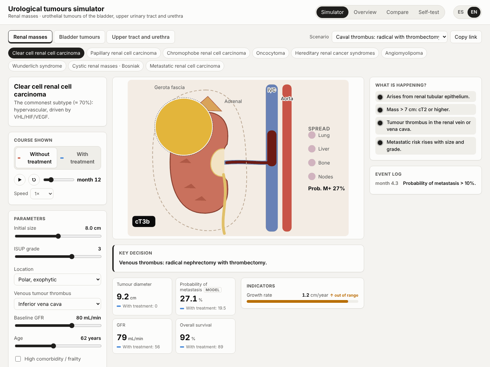

# Urological tumours simulator

**Renal masses · urothelial tumours of the bladder, upper urinary tract and urethra**

An interactive teaching simulator of the tumours of the kidney and the urothelium. Pick an entity, change its size, grade, stage and the patient, choose a treatment, and watch the course over months or years on a live diagram: a kidney in the retroperitoneum for renal masses, or the urothelial wall in cross-section for bladder, upper-tract and urethral tumours. The **untreated** course is shown by default; the **treated** course is one click away for comparison.

**Live demo:** https://ferasmed-dev.github.io/urologic-tumours-simulator/ · English: https://ferasmed-dev.github.io/urologic-tumours-simulator/?lang=en



> Teaching tool · not for clinical use.

## What it shows

16 simulations in three blocks, with 66 ready-made scenarios:

| Block | Simulations |
|---|---|
| **Renal masses** | Clear cell, papillary and chromophobe renal cell carcinoma · oncocytoma · hereditary syndromes (VHL, hereditary papillary RCC, Birt-Hogg-Dubé, FH deficiency) · angiomyolipoma (classic, fat-poor, epithelioid; tuberous sclerosis) · Wunderlich syndrome · Bosniak cystic masses · metastatic renal cell carcinoma by IMDC risk |
| **Bladder tumours** | Non-muscle-invasive Ta/T1 by EAU risk group · carcinoma in situ · muscle-invasive cT2–T4a (neoadjuvant chemotherapy + cystectomy, trimodality therapy, urinary diversions) · advanced/metastatic urothelial carcinoma · squamous carcinoma and adenocarcinoma |
| **Upper tract and urethra** | Upper tract urothelial carcinoma (nephroureterectomy, endoscopic and segmental treatment, adjuvant platinum) · urethral carcinoma |

For each simulation:

- **Diagram.** The kidney view shows the tumour growing in place (polar or central), capsule breach, the renal-vein or caval thrombus, Gerota fascia and adrenal, ablation zones, partial-nephrectomy beds, removed kidneys, embolization coils, aneurysms, retroperitoneal haematoma, Bosniak walls, septa, calcifications and enhancing nodules, and a spread panel (lung, liver, bone, nodes). The wall view shows papillary fronds, flat CIS, invasion through lamina propria, muscle, fat and adjacent organ, TURBT depth, instillations (mitomycin, BCG), radiotherapy, laser, cystectomy with the chosen diversion, recurrences, and a mini map of where in the tract the tumour sits.
- **Sliders and toggles** for size, grade, stage, location, thrombus, kidney function, age, frailty, risk factors and treatment.
- **Without vs with treatment** on the same time axis, plus a **key decision** panel.
- **"What is happening?"** lights up each step as it happens; an **event log** records stage changes, surgery, re-TURBT, BCG response or failure, shock classes, cisplatin ineligibility, recurrences and so on.
- **Indicators** with reference or target ranges, **charts** (small multiples with hover) or a **data table**, an **entity card** (what it is, what happens, diagnosis, treatment) and **reference values**.
- Three more views: **Overview**, **Compare** (up to three entities side by side) and **Self-test** (17 short cases, each linked to the scenario that explains it).

Spanish and English, switchable at any time (`?lang=es|en`, remembered between visits). Light and dark themes follow the system setting. Works on mobile.

## Curriculum fit

For students and teachers at any Spanish medical faculty. The topic belongs to the shared core of the degree (Orden ECI/332/2008):

- **Modules:** III — *Formación clínica humana* (urological and nephrological pathology, oncology) and IV — *Procedimientos diagnósticos y terapéuticos* (imaging, endoscopy, surgery, systemic therapy), with pathology content from II/IV depending on the faculty.
- **Typical subjects:** Urología; Nefrología; Patología médica y quirúrgica del aparato urinario; Oncología médica / Oncología radioterápica; Anatomía patológica; Radiología.
- **MIR relevance:** high. TNM of renal carcinoma and caval thrombus, partial vs radical nephrectomy, angiomyolipoma (fat on CT, 4 cm, Wunderlich), Bosniak, VHL, metastatic renal carcinoma being chemoresistant, NMIBC risk groups, BCG vs mitomycin, CIS, TURBT staging limits, neoadjuvant cisplatin and cystectomy, urinary diversions, upper-tract tumours (not a renal tumour), squamous carcinoma and schistosomiasis are recurring MIR topics.

Topic metadata for catalogues is in [`curriculum.json`](curriculum.json).

## For teachers

Every scenario has a link you can project or share; the table below lists all of them with what the model produces. Links open on the untreated course; press "With treatment" to compare. Remove `&lang=en` for Spanish, and add `&autoplay=0` to start paused. Any custom set-up can be shared with the **Copy link** button.

## Presets: expected results

Values are the last time point of each run, without → with treatment (first two charted variables). They are checked automatically in `tests/model.test.js`.

**Renal masses**

| Preset (deep link) | Simulation | End of run: without → with treatment | Key events (with treatment) |
|---|---|---|---|
| [1.8 cm mass in a 78-year-old: surveillance](https://ferasmed-dev.github.io/urologic-tumours-simulator/?preset=ccSmallSurveillance&lang=en) `ccSmallSurveillance` | Clear cell renal cell carcinoma (60 months) | Tumour diameter 2.8 → 2.8 cm; Probability of metastasis 2.7 → 2.7 % | Active surveillance |
| [3.5 cm cT1a: partial nephrectomy](https://ferasmed-dev.github.io/urologic-tumours-simulator/?preset=ccT1aPartial&lang=en) `ccT1aPartial` | Clear cell renal cell carcinoma (60 months) | Tumour diameter 6.4 → 0 cm; Probability of metastasis 8.3 → 2.4 % | Partial nephrectomy (pT1a) |
| [Radical nephrectomy in a patient with CKD](https://ferasmed-dev.github.io/urologic-tumours-simulator/?preset=ccRadicalCkd&lang=en) `ccRadicalCkd` | Clear cell renal cell carcinoma (60 months) | Tumour diameter 8.5 → 0 cm; Probability of metastasis 14.2 → 6.4 % | After radical nephrectomy GFR falls below 45 mL/min; Radical nephrectomy (pT1b); GFR < 45 mL/min (CKD G3b) |
| [9 cm central tumour: radical](https://ferasmed-dev.github.io/urologic-tumours-simulator/?preset=ccLargeCentral&lang=en) `ccLargeCentral` | Clear cell renal cell carcinoma (60 months) | Tumour diameter 14.8 → 0 cm; Probability of metastasis 74.4 → 45.7 % | Radical nephrectomy (pT3a); Probability of metastasis > 10% |
| [Caval thrombus: radical with thrombectomy](https://ferasmed-dev.github.io/urologic-tumours-simulator/?preset=ccCavalThrombus&lang=en) `ccCavalThrombus` | Clear cell renal cell carcinoma (60 months) | Tumour diameter 14 → 0 cm; Probability of metastasis 80.1 → 65.3 % | Radical nephrectomy with thrombectomy; Radical nephrectomy (pT3b); Probability of metastasis > 10% |
| [Stauffer syndrome](https://ferasmed-dev.github.io/urologic-tumours-simulator/?preset=ccStauffer&lang=en) `ccStauffer` | Clear cell renal cell carcinoma (60 months) | Tumour diameter 13.1 → 0 cm; Probability of metastasis 62.7 → 45.7 % | Now cT3a; Radical nephrectomy (pT3a); Alkaline phosphatase and calcium back to normal; Probability of metastasis > 10% |
| [Ablation in a frail patient](https://ferasmed-dev.github.io/urologic-tumours-simulator/?preset=ccAblationElderly&lang=en) `ccAblationElderly` | Clear cell renal cell carcinoma (60 months) | Tumour diameter 5.3 → 0 cm; Probability of metastasis 6.4 → 2.4 % | Thermal ablation (cT1a) |
| [Ablation of a 5.5 cm tumour](https://ferasmed-dev.github.io/urologic-tumours-simulator/?preset=ccAblationTooBig&lang=en) `ccAblationTooBig` | Clear cell renal cell carcinoma (60 months) | Tumour diameter 9.2 → 0 cm; Probability of metastasis 16.1 → 6.4 % | Ablation of a tumour > 4 cm: poorer local control; Thermal ablation (cT1b); Local recurrence after ablation > 10% |
| [Surveillance that triggers intervention](https://ferasmed-dev.github.io/urologic-tumours-simulator/?preset=ccSurveillanceTrigger&lang=en) `ccSurveillanceTrigger` | Clear cell renal cell carcinoma (60 months) | Tumour diameter 7.6 → 0 cm; Probability of metastasis 20 → 4.2 % | Active surveillance; Growth > 0.5 cm/year or ≥ 4 cm: intervention; Partial nephrectomy (pT1a) |
| [3.5 cm papillary carcinoma](https://ferasmed-dev.github.io/urologic-tumours-simulator/?preset=papillaryPartial&lang=en) `papillaryPartial` | Papillary renal cell carcinoma (60 months) | Tumour diameter 5.2 → 0 cm; Probability of metastasis 6.1 → 1.9 % | Partial nephrectomy (pT1a) |
| [High-grade central papillary carcinoma](https://ferasmed-dev.github.io/urologic-tumours-simulator/?preset=papillaryHighGrade&lang=en) `papillaryHighGrade` | Papillary renal cell carcinoma (60 months) | Tumour diameter 12.7 → 0 cm; Probability of metastasis 71.5 → 12.9 % | Radical nephrectomy (pT1b); Probability of metastasis > 10% |
| [8 cm chromophobe carcinoma](https://ferasmed-dev.github.io/urologic-tumours-simulator/?preset=chromophobeLarge&lang=en) `chromophobeLarge` | Chromophobe renal cell carcinoma (60 months) | Tumour diameter 10 → 0 cm; Probability of metastasis 13.1 → 8.7 % | Radical nephrectomy (pT2a) |
| [Oncocytoma: surveillance](https://ferasmed-dev.github.io/urologic-tumours-simulator/?preset=oncocytomaSurveillance&lang=en) `oncocytomaSurveillance` | Oncocytoma (60 months) | Tumour diameter 4.3 → 4.3 cm; Probability of metastasis 0 → 0 % | Active surveillance; Now cT1b |
| [Oncocytoma treated with radical nephrectomy](https://ferasmed-dev.github.io/urologic-tumours-simulator/?preset=oncocytomaRadical&lang=en) `oncocytomaRadical` | Oncocytoma (60 months) | Tumour diameter 6 → 0 cm; Probability of metastasis 0 → 0 % | Radical nephrectomy (pT1b); Pathology: oncocytoma, benign |
| [Von Hippel-Lindau: 3-cm rule](https://ferasmed-dev.github.io/urologic-tumours-simulator/?preset=vhlThreeCm&lang=en) `vhlThreeCm` | Hereditary renal cancer syndromes (20 years) | Largest tumour 11 → 1.6 cm; Probability of metastasis 41.3 → 2.4 % | Enucleation of the tumours in one kidney |
| [Von Hippel-Lindau: radical nephrectomy of each kidney](https://ferasmed-dev.github.io/urologic-tumours-simulator/?preset=vhlRadicalEach&lang=en) `vhlRadicalEach` | Hereditary renal cancer syndromes (20 years) | Largest tumour 11 → 0 cm; Probability of metastasis 41.3 → 0.1 % | Radical nephrectomy of one kidney; GFR < 15 mL/min: dialysis |
| [Birt-Hogg-Dubé](https://ferasmed-dev.github.io/urologic-tumours-simulator/?preset=bhdSlow&lang=en) `bhdSlow` | Hereditary renal cancer syndromes (20 years) | Largest tumour 5.4 → 2 cm; Probability of metastasis 3.7 → 0.5 % | Enucleation of the tumours in one kidney |
| [Fumarate hydratase deficiency](https://ferasmed-dev.github.io/urologic-tumours-simulator/?preset=hlrccAggressive&lang=en) `hlrccAggressive` | Hereditary renal cancer syndromes (20 years) | Largest tumour 20 → 0 cm; Probability of metastasis 100 → 0 % | Early surgery with a wide margin; FH deficiency: do not apply the 3-cm rule |
| [2.5 cm angiomyolipoma](https://ferasmed-dev.github.io/urologic-tumours-simulator/?preset=amlSmall&lang=en) `amlSmall` | Angiomyolipoma (10 years) | Diameter 4 → 4 cm; Annual bleeding risk 0.3 → 0.3 % | Ultrasound surveillance; Size ≥ 4 cm |
| [6 cm angiomyolipoma: embolization](https://ferasmed-dev.github.io/urologic-tumours-simulator/?preset=amlLargeEmbolization&lang=en) `amlLargeEmbolization` | Angiomyolipoma (10 years) | Diameter 7.5 → 4.2 cm; Annual bleeding risk 4.7 → 0.2 % | Size ≥ 4 cm; Selective arterial embolization |
| [Angiomyolipoma with an aneurysm](https://ferasmed-dev.github.io/urologic-tumours-simulator/?preset=amlAneurysm&lang=en) `amlAneurysm` | Angiomyolipoma (10 years) | Diameter 5 → 2.7 cm; Annual bleeding risk 4.7 → 0.1 % | Selective arterial embolization |
| [Tuberous sclerosis: everolimus](https://ferasmed-dev.github.io/urologic-tumours-simulator/?preset=amlTscEverolimus&lang=en) `amlTscEverolimus` | Angiomyolipoma (10 years) | Diameter 11 → 3.8 cm; Annual bleeding risk 13.6 → 0.5 % | Size ≥ 4 cm; Everolimus |
| [Epithelioid angiomyolipoma](https://ferasmed-dev.github.io/urologic-tumours-simulator/?preset=amlEpithelioid&lang=en) `amlEpithelioid` | Angiomyolipoma (10 years) | Diameter 15 → 0 cm; Annual bleeding risk 14.1 → 0 % | Size ≥ 4 cm; Partial nephrectomy |
| [Wunderlich: embolization at 1.5 h](https://ferasmed-dev.github.io/urologic-tumours-simulator/?preset=wunderlichEmbolization&lang=en) `wunderlichEmbolization` | Wunderlich syndrome (12 h) | Haemoglobin 7.7 → 13.2 g/dL; Mean arterial pressure 47.5 → 85 mmHg | Transfusion; Selective arterial embolization; Bleeding controlled |
| [Wunderlich on anticoagulation, late embolization](https://ferasmed-dev.github.io/urologic-tumours-simulator/?preset=wunderlichAnticoagDelay&lang=en) `wunderlichAnticoagDelay` | Wunderlich syndrome (12 h) | Haemoglobin 3.5 → 10.4 g/dL; Mean arterial pressure 25 → 76.4 mmHg | Transfusion; Class II shock (> 750 mL); Class III shock (> 1500 mL); Selective arterial embolization |
| [Bosniak I](https://ferasmed-dev.github.io/urologic-tumours-simulator/?preset=bosniakI&lang=en) `bosniakI` | Cystic renal masses · Bosniak (60 months) | Size 4.4 → 4.4 cm; Probability of malignancy 0 → 0 % | Discharged: no follow-up needed |
| [Bosniak IIF: follow-up](https://ferasmed-dev.github.io/urologic-tumours-simulator/?preset=bosniakIIF&lang=en) `bosniakIIF` | Cystic renal masses · Bosniak (60 months) | Size 4.6 → 4.6 cm; Probability of malignancy 10 → 10 % | Follow-up imaging no. 1 |
| [Bosniak III: surgery](https://ferasmed-dev.github.io/urologic-tumours-simulator/?preset=bosniakIII&lang=en) `bosniakIII` | Cystic renal masses · Bosniak (60 months) | Size 5.1 → 0 cm; Probability of malignancy 50 → 50 % | Partial nephrectomy; Some of these lesions will prove benign on the specimen |
| [Bosniak IV: surgery](https://ferasmed-dev.github.io/urologic-tumours-simulator/?preset=bosniakIV&lang=en) `bosniakIV` | Cystic renal masses · Bosniak (60 months) | Size 7.2 → 0 cm; Probability of malignancy 90 → 90 % | Partial nephrectomy |
| [Metastatic, intermediate risk: pembrolizumab + axitinib](https://ferasmed-dev.github.io/urologic-tumours-simulator/?preset=mrccIoTki&lang=en) `mrccIoTki` | Metastatic renal cell carcinoma (60 months) | Relative tumour burden 2000 → 88.3 %; Overall survival 1.7 → 21.9 % | Partial response (burden < 70%); Progression after response |
| [Metastatic, favourable risk: sunitinib](https://ferasmed-dev.github.io/urologic-tumours-simulator/?preset=mrccFavourableTki&lang=en) `mrccFavourableTki` | Metastatic renal cell carcinoma (60 months) | Relative tumour burden 2000 → 2000 %; Overall survival 17.4 → 36.4 % | — |
| [Metastatic, poor risk with cytoreductive nephrectomy](https://ferasmed-dev.github.io/urologic-tumours-simulator/?preset=mrccPoorCytoreductive&lang=en) `mrccPoorCytoreductive` | Metastatic renal cell carcinoma (60 months) | Relative tumour burden 2000 → 1942 %; Overall survival 0 → 0.3 % | Cytoreductive nephrectomy; Intermediate or poor risk: immediate cytoreductive nephrectomy does not improve survival |
| [Metastatic disease treated with chemotherapy](https://ferasmed-dev.github.io/urologic-tumours-simulator/?preset=mrccChemotherapy&lang=en) `mrccChemotherapy` | Metastatic renal cell carcinoma (60 months) | Relative tumour burden 2000 → 2000 %; Overall survival 1.7 → 1.7 % | Chemotherapy: no response (resistant tumour) |

**Bladder tumours**

| Preset (deep link) | Simulation | End of run: without → with treatment | Key events (with treatment) |
|---|---|---|---|
| [Single low-grade Ta: low risk](https://ferasmed-dev.github.io/urologic-tumours-simulator/?preset=nmibcLowRisk&lang=en) `nmibcLowRisk` | Non-muscle-invasive bladder tumour (Ta, T1) (60 months) | Probability of tumour in the bladder 100 → 21.3 %; Probability of progression to muscle invasion 10 → 1 % | TURBT: Ta confirmed; muscle present in the sample; Single postoperative mitomycin instillation |
| [Multiple recurrent low-grade Ta](https://ferasmed-dev.github.io/urologic-tumours-simulator/?preset=nmibcIntermediate&lang=en) `nmibcIntermediate` | Non-muscle-invasive bladder tumour (Ta, T1) (60 months) | Probability of tumour in the bladder 100 → 31.5 %; Probability of progression to muscle invasion 20 → 6 % | TURBT: Ta confirmed; muscle present in the sample; Mitomycin C induction |
| [High-grade T1: re-TURBT + BCG](https://ferasmed-dev.github.io/urologic-tumours-simulator/?preset=nmibcHighBcg&lang=en) `nmibcHighBcg` | Non-muscle-invasive bladder tumour (Ta, T1) (60 months) | Probability of tumour in the bladder 100 → 45 %; Probability of progression to muscle invasion 55 → 11.3 % | TURBT: T1 confirmed; muscle present in the sample; High grade: staging CT; Re-TURBT at 2–6 weeks (T1); BCG induction (6 weeks) |
| [High-grade T1 treated with mitomycin](https://ferasmed-dev.github.io/urologic-tumours-simulator/?preset=nmibcHighMmc&lang=en) `nmibcHighMmc` | Non-muscle-invasive bladder tumour (Ta, T1) (60 months) | Probability of tumour in the bladder 100 → 61.6 %; Probability of progression to muscle invasion 55 → 16.9 % | TURBT: T1 confirmed; muscle present in the sample; High grade: staging CT; High risk on mitomycin: does not reduce progression; BCG is better; Re-TURBT at 2–6 weeks (T1) |
| [High-grade T1 + CIS: BCG](https://ferasmed-dev.github.io/urologic-tumours-simulator/?preset=nmibcVeryHighBcg&lang=en) `nmibcVeryHighBcg` | Non-muscle-invasive bladder tumour (Ta, T1) (60 months) | Probability of tumour in the bladder 100 → 52.9 %; Probability of progression to muscle invasion 91.5 → 32 % | TURBT: T1 confirmed; muscle present in the sample; High grade: staging CT; Re-TURBT at 2–6 weeks (T1); BCG induction (6 weeks) |
| [High-grade T1 + CIS: early cystectomy](https://ferasmed-dev.github.io/urologic-tumours-simulator/?preset=nmibcVeryHighCystectomy&lang=en) `nmibcVeryHighCystectomy` | Non-muscle-invasive bladder tumour (Ta, T1) (60 months) | Probability of tumour in the bladder 100 → 0 %; Probability of progression to muscle invasion 91.5 → 8.5 % | TURBT: T1 confirmed; muscle present in the sample; High grade: staging CT; Early radical cystectomy |
| [Intermediate risk, still smoking](https://ferasmed-dev.github.io/urologic-tumours-simulator/?preset=nmibcSmoker&lang=en) `nmibcSmoker` | Non-muscle-invasive bladder tumour (Ta, T1) (60 months) | Probability of tumour in the bladder 100 → 38.9 %; Probability of progression to muscle invasion 23.5 → 7.1 % | TURBT: Ta confirmed; muscle present in the sample; Continued smoking increases recurrence: stop smoking; Mitomycin C induction |
| [CIS: BCG](https://ferasmed-dev.github.io/urologic-tumours-simulator/?preset=cisBcg&lang=en) `cisBcg` | Carcinoma in situ (CIS) (60 months) | Probability of persistent CIS 100 → 25 %; Probability of progression 54 → 14.9 % | Positive urine cytology (high grade); TURBT and biopsies; BCG induction; Complete response to BCG at 3 months |
| [BCG-unresponsive CIS](https://ferasmed-dev.github.io/urologic-tumours-simulator/?preset=cisBcgFailure&lang=en) `cisBcgFailure` | Carcinoma in situ (CIS) (60 months) | Probability of persistent CIS 100 → 80 %; Probability of progression 54 → 49.7 % | Positive urine cytology (high grade); TURBT and biopsies; BCG induction; CIS persists after BCG: unresponsive |
| [BCG-unresponsive CIS: cystectomy](https://ferasmed-dev.github.io/urologic-tumours-simulator/?preset=cisCystectomy&lang=en) `cisCystectomy` | Carcinoma in situ (CIS) (60 months) | Probability of persistent CIS 100 → 0 %; Probability of progression 54 → 5 % | Positive urine cytology (high grade); TURBT and biopsies; Radical cystectomy |
| [cT2: neoadjuvant chemotherapy + cystectomy](https://ferasmed-dev.github.io/urologic-tumours-simulator/?preset=mibcNacCystectomy&lang=en) `mibcNacCystectomy` | Muscle-invasive bladder tumour (60 months) | Overall survival 1.8 → 65.3 %; Probability of metastasis 98.6 → 28.4 % | Staging CT of chest, abdomen and pelvis; Neoadjuvant chemotherapy (gemcitabine + cisplatin); Radical cystectomy + ileal conduit (bricker) |
| [cT2 with GFR 45: no cisplatin](https://ferasmed-dev.github.io/urologic-tumours-simulator/?preset=mibcCisplatinIneligible&lang=en) `mibcCisplatinIneligible` | Muscle-invasive bladder tumour (60 months) | Overall survival 1.8 → 61.6 %; Probability of metastasis 98.6 → 32.9 % | Staging CT of chest, abdomen and pelvis; Not cisplatin-eligible (GFR < 60 or poor condition): no neoadjuvant chemotherapy; Radical cystectomy + ileal conduit (bricker) |
| [cT2: trimodality therapy](https://ferasmed-dev.github.io/urologic-tumours-simulator/?preset=mibcTrimodal&lang=en) `mibcTrimodal` | Muscle-invasive bladder tumour (60 months) | Overall survival 1.8 → 62.9 %; Probability of metastasis 98.6 → 32.9 % | Staging CT of chest, abdomen and pelvis; Trimodality with cisplatin as radiosensitiser |
| [cT3 with hydronephrosis: trimodality](https://ferasmed-dev.github.io/urologic-tumours-simulator/?preset=mibcTrimodalNotIdeal&lang=en) `mibcTrimodalNotIdeal` | Muscle-invasive bladder tumour (60 months) | Overall survival 0.1 → 35.2 %; Probability of metastasis 99.9 → 66.7 % | Staging CT of chest, abdomen and pelvis; Poor trimodality candidate (T3, hydronephrosis or incomplete TURBT); Trimodality with cisplatin as radiosensitiser; Persistent tumour: salvage cystectomy |
| [Frail cT3 N+: ureterostomy](https://ferasmed-dev.github.io/urologic-tumours-simulator/?preset=mibcFrailUreterostomy&lang=en) `mibcFrailUreterostomy` | Muscle-invasive bladder tumour (60 months) | Overall survival 0 → 9.7 %; Probability of metastasis 100 → 80.4 % | Staging CT of chest, abdomen and pelvis; Radical cystectomy + cutaneous ureterostomy; Ureterostomy stenosis; Probability of metastasis > 50% |
| [Young patient: Studer neobladder](https://ferasmed-dev.github.io/urologic-tumours-simulator/?preset=mibcStuder&lang=en) `mibcStuder` | Muscle-invasive bladder tumour (60 months) | Overall survival 2 → 69.5 %; Probability of metastasis 98.6 → 28.4 % | Staging CT of chest, abdomen and pelvis; Neoadjuvant chemotherapy (gemcitabine + cisplatin); Radical cystectomy + orthotopic neobladder (studer) |
| [Metastatic: enfortumab + pembrolizumab](https://ferasmed-dev.github.io/urologic-tumours-simulator/?preset=mucEvPembro&lang=en) `mucEvPembro` | Advanced or metastatic urothelial carcinoma (48 months) | Relative tumour burden 3000 → 585 %; Overall survival 0 → 30.7 % | Watch for neuropathy, rash and hyperglycaemia from enfortumab; Watch for immune-related adverse events; Partial response (burden < 70%); Progression after response |
| [Metastatic: gemcitabine/cisplatin → avelumab](https://ferasmed-dev.github.io/urologic-tumours-simulator/?preset=mucGemCisAvelumab&lang=en) `mucGemCisAvelumab` | Advanced or metastatic urothelial carcinoma (48 months) | Relative tumour burden 3000 → 3000 %; Overall survival 0 → 14.9 % | Watch for immune-related adverse events; Avelumab maintenance; Progression after response |
| [Metastatic with GFR 45](https://ferasmed-dev.github.io/urologic-tumours-simulator/?preset=mucCisplatinIneligible&lang=en) `mucCisplatinIneligible` | Advanced or metastatic urothelial carcinoma (48 months) | Relative tumour burden 3000 → 3000 %; Overall survival 0 → 0.7 % | Not cisplatin-eligible: regimen changed |
| [Metastatic, platinum-ineligible](https://ferasmed-dev.github.io/urologic-tumours-simulator/?preset=mucFrail&lang=en) `mucFrail` | Advanced or metastatic urothelial carcinoma (48 months) | Relative tumour burden 3000 → 3000 %; Overall survival 0 → 1.6 % | Platinum-ineligible: immunotherapy; Watch for immune-related adverse events |
| [Squamous carcinoma from a long-term catheter](https://ferasmed-dev.github.io/urologic-tumours-simulator/?preset=squamousCatheter&lang=en) `squamousCatheter` | Non-urothelial bladder tumours (60 months) | Overall survival 0.5 → 54.2 %; Probability of metastasis 99.3 → 43.9 % | Histology: squamous cell carcinoma; Radical cystectomy |
| [Squamous carcinoma from schistosomiasis (cT3)](https://ferasmed-dev.github.io/urologic-tumours-simulator/?preset=squamousSchistosomiasis&lang=en) `squamousSchistosomiasis` | Non-urothelial bladder tumours (60 months) | Overall survival 0 → 36.1 %; Probability of metastasis 99.9 → 65.8 % | Histology: squamous cell carcinoma; Radical cystectomy |
| [Squamous carcinoma treated with chemoradiotherapy](https://ferasmed-dev.github.io/urologic-tumours-simulator/?preset=squamousChemoRt&lang=en) `squamousChemoRt` | Non-urothelial bladder tumours (60 months) | Overall survival 0.5 → 43 %; Probability of metastasis 99.3 → 58.7 % | Histology: squamous cell carcinoma; Chemoradiotherapy; Poorly sensitive to chemotherapy and radiotherapy |
| [Urachal adenocarcinoma](https://ferasmed-dev.github.io/urologic-tumours-simulator/?preset=urachalAdenocarcinoma&lang=en) `urachalAdenocarcinoma` | Non-urothelial bladder tumours (60 months) | Overall survival 0.5 → 49.7 %; Probability of metastasis 99.3 → 49.3 % | Histology: adenocarcinoma; Partial cystectomy with urachus and umbilicus |

**Upper tract and urethra**

| Preset (deep link) | Simulation | End of run: without → with treatment | Key events (with treatment) |
|---|---|---|---|
| [High-risk upper tract tumour: nephroureterectomy](https://ferasmed-dev.github.io/urologic-tumours-simulator/?preset=utucHighRiskRnu&lang=en) `utucHighRiskRnu` | Upper tract urothelial carcinoma (60 months) | Overall survival 1.4 → 78.6 %; Depth of invasion T4 → Ta  | Nephroureterectomy with bladder cuff; Adjuvant therapy not indicated (pT < 2 or endoscopic treatment); GFR < 60: no longer cisplatin-eligible; Bladder recurrence |
| [Low-risk upper tract tumour: laser](https://ferasmed-dev.github.io/urologic-tumours-simulator/?preset=utucLowRiskEndoscopic&lang=en) `utucLowRiskEndoscopic` | Upper tract urothelial carcinoma (60 months) | Overall survival 72.2 → 81.6 %; Depth of invasion T1 → Ta  | Ureteroscopy and laser ablation; Adjuvant therapy not indicated (pT < 2 or endoscopic treatment); Bladder recurrence; Upper-tract recurrence: re-treatment |
| [High-risk tumour treated with laser](https://ferasmed-dev.github.io/urologic-tumours-simulator/?preset=utucHighRiskEndoscopic&lang=en) `utucHighRiskEndoscopic` | Upper tract urothelial carcinoma (60 months) | Overall survival 1.4 → 67.9 %; Depth of invasion T4 → T3  | Endoscopic treatment of a high-risk tumour: understaging; Ureteroscopy and laser ablation; Adjuvant therapy not indicated (pT < 2 or endoscopic treatment); Upper-tract recurrence: re-treatment |
| [Distal ureter: segmental ureterectomy](https://ferasmed-dev.github.io/urologic-tumours-simulator/?preset=utucDistalSegmental&lang=en) `utucDistalSegmental` | Upper tract urothelial carcinoma (60 months) | Overall survival 72.2 → 82.2 %; Depth of invasion T1 → Ta  | Distal segmental ureterectomy with reimplantation; Adjuvant therapy not indicated (pT < 2 or endoscopic treatment); Bladder recurrence |
| [Invasive on CT: nephroureterectomy + adjuvant](https://ferasmed-dev.github.io/urologic-tumours-simulator/?preset=utucInvasiveAdjuvant&lang=en) `utucInvasiveAdjuvant` | Upper tract urothelial carcinoma (60 months) | Overall survival 0 → 72.9 %; Depth of invasion T4 → Ta  | Invades the muscle layer; Nephroureterectomy with bladder cuff; GFR < 60 after surgery: adjuvant carboplatin; GFR < 60: no longer cisplatin-eligible |
| [Urethra: superficial tumour](https://ferasmed-dev.github.io/urologic-tumours-simulator/?preset=urethraSuperficial&lang=en) `urethraSuperficial` | Urethral tumour (60 months) | Overall survival 37.2 → 74.5 %; Depth of invasion T3 → Ta  | Distal urethra: squamous histology likely; Local resection / laser |
| [Urethra: infiltrating tumour](https://ferasmed-dev.github.io/urologic-tumours-simulator/?preset=urethraInfiltrating&lang=en) `urethraInfiltrating` | Urethral tumour (60 months) | Overall survival 8.8 → 47.6 %; Depth of invasion T4 → Ta  | Distal urethra: squamous histology likely; Penectomy (partial or total) or urethrectomy |
| [Infiltrating urethral tumour with local resection](https://ferasmed-dev.github.io/urologic-tumours-simulator/?preset=urethraUndertreated&lang=en) `urethraUndertreated` | Urethral tumour (60 months) | Overall survival 8.8 → 23.4 %; Depth of invasion T4 → T3  | Distal urethra: squamous histology likely; Local resection / laser; Treatment insufficient for the extent |
| [Locally advanced female urethral tumour](https://ferasmed-dev.github.io/urologic-tumours-simulator/?preset=urethraFemaleAdvanced&lang=en) `urethraFemaleAdvanced` | Urethral tumour (60 months) | Overall survival 0.5 → 21.1 %; Depth of invasion T4 → Ta  | Chemotherapy + surgery + radiotherapy |

## How the model works

Every simulation is a deterministic, time-stepped model in plain JavaScript (`src/model/`). Both arms start from the same state; the chosen treatment starts at a fixed time in the treated arm (month 1 for most, month 0.5 for TURBT, a few hours for Wunderlich syndrome). Probabilities are shown as expected values for a patient with that profile, not as random draws.

**Solid renal tumours** (`renal.js`):
- Growth: logistic, d' = k·d·(1 − d/20 cm), with k by histology and ISUP grade (clear cell 0.10–0.40/year, papillary 0.07–0.28, chromophobe 0.08, oncocytoma 0.05), so small masses grow ≈ 0.2–0.5 cm/year.
- cT from size (T1a ≤ 4, T1b ≤ 7, T2a ≤ 10, T2b > 10 cm), renal-vein (T3a) or caval (T3b) thrombus, perinephric invasion of large high-grade tumours (T3a).
- Untreated metastatic hazard: the larger of a size/grade hazard (0.004·e^{0.32(d−3)} × grade factor × histology factor per year) and 1.5 × the post-surgical recurrence hazard of the current stage. After surgery, a constant hazard giving the 5-year recurrence of the pathological stage (T1a 3% … T3b 50%, × grade factor).
- Kidney function: partial nephrectomy −8%, ablation −3%, radical −38% with partial compensation to −28% over months; age-related decline 1 mL/min/year.
- Survival: other-cause mortality (Gompertz by age, ×2.5 if frail) + 0.5/year × probability of metastasis + a small excess when GFR < 60.
- Active surveillance: imaging every 6 months; intervention if ≥ 4 cm or growth > 0.5 cm/year.

**Hereditary syndromes:** new tumours appear in alternate kidneys at a syndrome-specific interval; tumours < 3 cm carry 10% of the usual hazard except in FH deficiency. Each enucleation removes 5–8% of a kidney's parenchyma; GFR = baseline × (remaining fraction)^0.55.

**Angiomyolipoma:** linear growth (sporadic 0.15 cm/year, tuberous sclerosis ×4, epithelioid ×6); annual bleeding hazard 0.3% below 4 cm, rising 5% per 4 cm above it, ×3 with an aneurysm ≥ 5 mm, ×1.5 in tuberous sclerosis. **Wunderlich:** bleeding rate (300 + 60 × (size − 4)) mL/h, ×1.8 on anticoagulation, tamponade time constant 4 h; haemoglobin diluted by crystalloid; MAP falls with net loss above 700 mL; embolization stops the bleeding within minutes.

**Bosniak:** probability of malignancy per category; malignant cysts behave as indolent, low-grade carcinomas.

**Metastatic disease** (renal and urothelial): Weibull overall survival (shape 1.1–1.2) with the median of each regimen, and a relative tumour-burden curve where each regimen's cell kill is set against tumour growth (anti-angiogenic: strong then resistance; immunotherapy: slower, durable).

**Non-muscle-invasive bladder cancer:** cumulative recurrence F(t) = 1 − exp(−H₅ · m · (t/60)^0.7) and progression with a constant hazard, where H₅ comes from the 5-year probability of the EAU risk group after TURBT alone and m is the multiplier of the chosen adjuvant regimen (single instillation, mitomycin, BCG, cystectomy) and of continued smoking. Untreated tumours deepen through the wall at a rate consistent with their 5-year probability of muscle invasion.

**Depth of invasion:** a continuous index through the wall (0 Ta/Tis, 0.15–1 T1, 1–2 T2, 2–3 T3, ≥ 3 T4). The upper-tract wall is drawn thinner and invasion progresses 1.5 × faster than in the bladder.

**Muscle-invasive, non-urothelial, upper-tract and urethral tumours:** a constant cancer hazard from the 5-year survival of the stage after definitive treatment, with multipliers for neoadjuvant cisplatin (0.84), nodal disease (1.9), poor trimodality candidates (1.35), chemoradiotherapy in squamous carcinoma (1.5), adjuvant platinum after nephroureterectomy (0.7), endoscopic treatment of high-risk upper-tract tumours (2.5) and undertreatment of urethral tumours (2.2). Untreated disease follows a Weibull curve with stage-specific median survival.

Values marked **Model** in the app are tuning choices or simplifications of the simulator, not measured clinical figures.

### Main parameters and their basis

| Parameter | Value | Basis |
|---|---|---|
| cT categories of renal carcinoma | T1a ≤ 4 · T1b 4–7 · T2a 7–10 · T2b > 10 cm · T3a renal vein/fat · T3b infradiaphragmatic cava | TNM 8th edition |
| Partial vs radical nephrectomy | Partial for cT1 (and selected cT2) when feasible; radical if > 7 cm, central or with thrombus; imperative partial if radical would leave GFR < 45 | EAU guideline |
| Active surveillance triggers | ≥ 4 cm or growth > 0.5 cm/year | EAU / DISSRM data |
| Ablation | Small masses (≤ 3–4 cm), older or frail patients; biopsy first | EAU guideline |
| Angiomyolipoma | Fat ≤ −10 HU diagnostic; treat if > 4 cm, aneurysm ≥ 5 mm or symptoms | EAU guideline, classic threshold |
| Bosniak malignancy | I–II ≈ 0 · IIF ≈ 10% · III ≈ 50% · IV ≈ 90% | Bosniak 2019 and meta-analyses |
| Hereditary RCC | Intervene at ≈ 3 cm; FH deficiency without delay | VHL/NCI practice |
| mRCC median OS | Sunitinib 43 / 22.5 / 7.8 months by IMDC; HR pembrolizumab + axitinib 0.73, nivolumab + ipilimumab 0.72 (int/poor) | IMDC series, KEYNOTE-426, CheckMate 214 |
| NMIBC 5-year recurrence / progression after TURBT alone | Low 31% / 1% · intermediate 50% / 6% · high 70% / 17% · very high 78% / 45% | EORTC 2006, EAU 2021 tables (tuning) |
| Adjuvant effects | Single instillation ≈ −35% recurrence; BCG ≈ −27% progression in high risk; mitomycin no effect on progression | Sylvester meta-analyses |
| CIS progression without BCG | ≈ 54% at 5 years | Classic series |
| Cisplatin eligibility | GFR ≥ 60 mL/min and good performance status | Galsky criteria |
| Neoadjuvant cisplatin | Survival benefit ≈ 5% absolute (HR ≈ 0.86) | ABC meta-analysis |
| 5-year survival after cystectomy | pT2 ≈ 70% · pT3 ≈ 50% · pT4a ≈ 35% | Large cystectomy series |
| Metastatic urothelial median OS | EV + pembrolizumab 31.5 · gem/cis 14 · gem/cis → avelumab 21 · gem/carbo 9.3 · pembrolizumab 11 months | EV-302, JAVELIN Bladder 100, KEYNOTE-052/-045 |
| UTUC low risk | Unifocal, < 2 cm, low grade, no invasion on CT | EAU guideline |
| Bladder recurrence after UTUC | 22–47% | EAU guideline |
| Adjuvant platinum after nephroureterectomy | pT2+ or N+; carboplatin if GFR < 60 | POUT |
| Growth constants, hazard factors, depth rates, haemorrhage dynamics | see `src/model/` | Tuning assumption (Model) |

### Known simplifications

- Each run is one "average" patient with that profile; probabilities are expected values, not individual outcomes.
- Growth and invasion are smooth curves; real tumours vary widely.
- Survival multipliers are drawn from trials and series in different populations and combined multiplicatively.
- The depth-of-invasion index is a teaching proxy; real staging is pathological.
- Doses, regimens and approvals are summarised for teaching; check current guidelines and local protocols before any real decision.

## Layout

```
index.html
src/model.js              public API: entities, presets, key decisions, model tags
src/model/core.js         shared engine (run, runBoth, sanitize…)
src/model/onco.js         shared oncology helpers (hazards, Weibull, wall staging)
src/model/renal.js        renal masses
src/model/bladder.js      bladder tumours
src/model/upper.js        upper tract and urethra
src/i18n.js               Spanish + English strings, self-test questions
src/ui.js                 DOM, playback, views, deep links, window.__sim hook
src/schematic.js          SVG kidney and urothelial-wall diagrams
src/charts.js             dependency-free SVG charts
src/styles.css
tests/model.test.js       staging, mechanisms and every preset
tests/i18n.test.js        every string the model can emit exists in both languages
curriculum.json
```

## Run locally

No build step and no dependencies.

```bash
python3 -m http.server 8000
# open http://localhost:8000
```

## Tests

```bash
npm test     # node --test (Node 18+)
```

The tests check every entity in both arms (finite, bounded values; extremes of every slider; purity), staging boundaries (renal TNM, wall depth, NMIBC risk groups, Bosniak, UTUC low risk), key mechanisms (size and grade vs metastasis, partial vs radical kidney function, ablation by size, AML bleeding, BCG vs mitomycin, cisplatin eligibility, nephroureterectomy vs endoscopic treatment, benefit of treatment on survival), every preset's expected behaviour and the completeness of both languages. GitHub Actions runs them on every push.

## Deploy (GitHub Pages)

1. Create an empty public repository named `urologic-tumours-simulator`.
2. Push these files to `main` (with `index.html` at the root).
3. Settings → Pages → Deploy from a branch → `main` / `(root)`.
4. After 1–2 minutes the site is live at https://ferasmed-dev.github.io/urologic-tumours-simulator/.

## References

- EAU Guidelines: Renal Cell Carcinoma; Non-muscle-invasive Bladder Cancer; Muscle-invasive and Metastatic Bladder Cancer; Upper Urinary Tract Urothelial Carcinoma; Primary Urethral Carcinoma. European Association of Urology, current editions.
- Moch H, et al. The 2022 World Health Organization classification of tumours of the urinary system and male genital organs. Eur Urol. 2022;82:458–68.
- Amin MB, et al. AJCC Cancer Staging Manual, 8th ed. Springer; 2017.
- Silverman SG, et al. Bosniak classification of cystic renal masses, version 2019. Radiology. 2019;292:475–88.
- Pierorazio PM, et al. Five-year analysis of a multi-institutional prospective clinical trial of delayed intervention and surveillance for small renal masses (DISSRM). J Urol. 2015;194:629–36.
- Leibovich BC, et al. Prediction of progression after radical nephrectomy for patients with clear cell renal cell carcinoma. Cancer. 2003;97:1663–71.
- Heng DY, et al. Prognostic factors for overall survival in patients with metastatic RCC treated with VEGF-targeted agents (IMDC). J Clin Oncol. 2009;27:5794–9.
- Rini BI, et al. Pembrolizumab plus axitinib versus sunitinib for advanced RCC (KEYNOTE-426). N Engl J Med. 2019;380:1116–27; Motzer RJ, et al. Nivolumab plus ipilimumab versus sunitinib (CheckMate 214). N Engl J Med. 2018;378:1277–90.
- Méjean A, et al. Sunitinib alone or after nephrectomy in metastatic RCC (CARMENA). N Engl J Med. 2018;379:417–27.
- Choueiri TK, et al. Adjuvant pembrolizumab after nephrectomy in RCC (KEYNOTE-564). N Engl J Med. 2021;385:683–94.
- Bissler JJ, et al. Everolimus for angiomyolipoma associated with tuberous sclerosis complex (EXIST-2). Lancet. 2013;381:817–24.
- Jonasch E, et al. Belzutifan for renal cell carcinoma in von Hippel-Lindau disease. N Engl J Med. 2021;385:2036–46.
- Sylvester RJ, et al. Predicting recurrence and progression in individual patients with stage Ta T1 bladder cancer using EORTC risk tables. Eur Urol. 2006;49:466–77; Sylvester RJ, et al. EAU NMIBC prognostic factor risk groups. Eur Urol. 2021;79:480–8.
- Sylvester RJ, et al. Systematic review and individual patient data meta-analysis of a single immediate instillation after TURBT. Eur Urol. 2016;69:231–44; Sylvester RJ, et al. Intravesical BCG reduces the risk of progression. J Urol. 2002;168:1964–70.
- Advanced Bladder Cancer Meta-analysis Collaboration. Neoadjuvant chemotherapy in invasive bladder cancer. Eur Urol. 2005;48:202–6.
- Galsky MD, et al. A consensus definition of patients with metastatic urothelial carcinoma who are unfit for cisplatin. J Clin Oncol. 2011;29:2432–8.
- Stein JP, et al. Radical cystectomy in the treatment of invasive bladder cancer: long-term results in 1,054 patients. J Clin Oncol. 2001;19:666–75.
- James ND, et al. Radiotherapy with or without chemotherapy in muscle-invasive bladder cancer (BC2001). N Engl J Med. 2012;366:1477–88.
- Powles T, et al. Enfortumab vedotin and pembrolizumab in untreated advanced urothelial cancer (EV-302). N Engl J Med. 2024;390:875–88.
- Powles T, et al. Avelumab maintenance therapy for advanced or metastatic urothelial carcinoma (JAVELIN Bladder 100). N Engl J Med. 2020;383:1218–30.
- Powles T, et al. Durvalumab with neoadjuvant chemotherapy in operable bladder cancer (NIAGARA). N Engl J Med. 2024;391:1773–86.
- Birtle A, et al. Adjuvant chemotherapy in upper tract urothelial carcinoma (POUT). Lancet. 2020;395:1268–77.

## Licence

MIT © 2026 Feras Elhissi. Teaching tool · not for clinical use.
